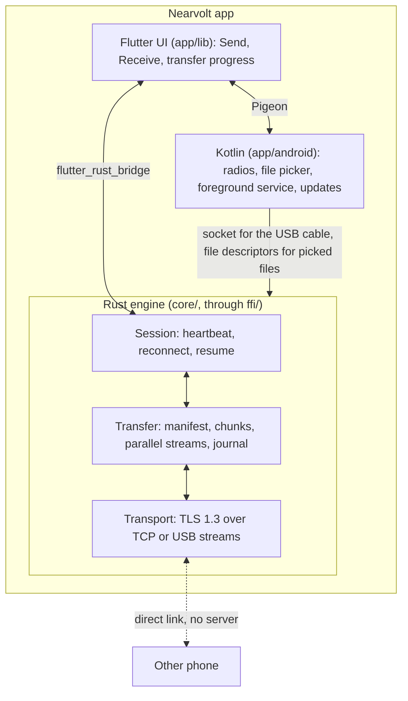
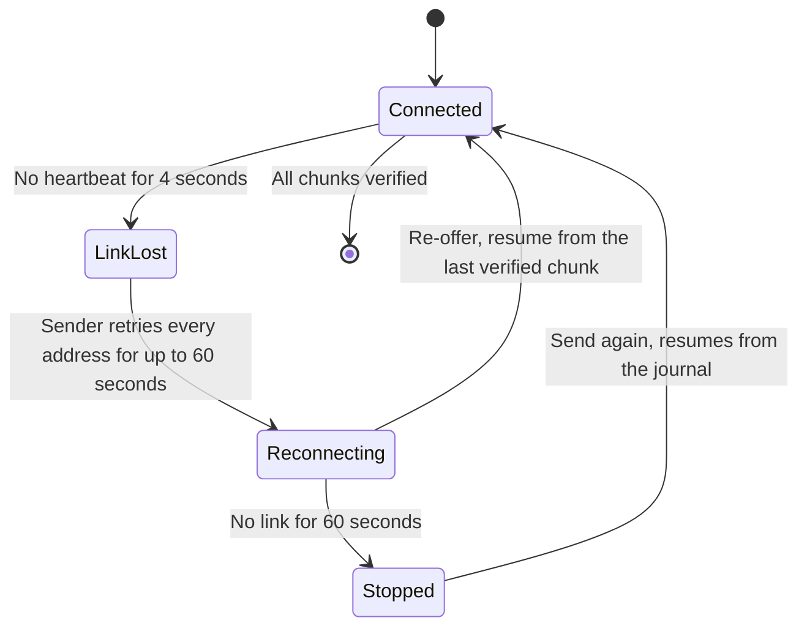
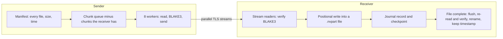

# Nearvolt architecture

Nearvolt moves files directly between nearby Android phones and tablets at the
maximum speed the link allows, with no server, no account and no internet.

Goals, in priority order:

1. **No data loss.** Every byte is verified. Interrupted transfers resume from the
   last verified chunk.
2. **Connections that don't drop easily.** When a link does drop, the transfer
   recovers on its own within seconds.
3. **Maximum speed.** The fastest available link, kept full with parallel streams.
4. **Simple.** Two pages and a prompt, no ads, no sign-up, a clean light design.

## Layers



| Layer | Technology | Why |
|---|---|---|
| Engine | Rust | Native speed, and memory safety rules out most security bugs |
| Transport | TLS 1.3 (`rustls`), 1 control + 8 data streams | Measured 3x faster than QUIC and cheaper on CPU, which matters for battery and heat |
| Verification | BLAKE3 | Faster than SHA-256 and parallel |
| UI | Flutter, atomic design (`theme`, `ui/atoms`, `molecules`, `organisms`, `templates`, `pages`) | One set of building blocks reused by every page |
| UI to engine | `flutter_rust_bridge` | Type-safe calls and event streams from Dart into Rust |
| UI to Android | Pigeon | One typed interface (`app/pigeons/platform.dart`) instead of string channels |

## Ways to connect

Every way to connect ends in the same thing: the sender gets the receiver's
ticket (or a USB stream) and the engine takes over.

| How | What happens | Pairing |
|---|---|---|
| Nearby list, same Wi-Fi | The receiver advertises its public ticket over mDNS (`_nearvolt._tcp`) | 4-digit code |
| Nearby list, Bluetooth | The receiver advertises over Bluetooth LE; the sender reads the public ticket from a GATT characteristic | 4-digit code |
| QR code | The sender scans the receiver's private ticket with Google's code scanner | Secret in the ticket |
| NFC tap | The receiver's phone acts as an NFC card (host card emulation) serving its private ticket | Secret in the ticket |
| USB cable | Android Open Accessory, with streams multiplexed by yamux | 4-digit code |

When the two phones don't share a network, the receiver has already created a
Wi-Fi Direct group on the router's channel, and the ticket carries its name,
passphrase and frequency. The sender joins it without a pop-up after 2.5 seconds
without a connection, while the engine keeps trying every address in the ticket.

Finding a phone and moving files are separate jobs. Bluetooth, NFC, the local
network's service records and QR codes only exchange the ticket; files always
travel over Wi-Fi (the shared network or Wi-Fi Direct) or the USB cable. Every
finding method runs at once, only while Send or Receive is open, so the first to
succeed wins. Once a transfer starts they all stop: the sender stops searching,
and the receiver stops advertising and closes its Wi-Fi Direct group unless the
sender joined it.

## Staying connected

| Cause of drops | Fix |
|---|---|
| Wi-Fi Direct on a different channel from the home router | The group is created on the router's channel |
| Background Wi-Fi scans and radio power saving | Low-latency Wi-Fi lock and wake lock during transfers |
| The system killing a background app | `connectedDevice` foreground service with progress in a notification |
| Silent link loss | Heartbeat every 500 ms; 4 seconds of silence means the link is gone |
| A cable pulled out | The engine waits for it to be plugged back in and resumes |

The **session** is separate from the **connection**: it has its own ID and a
journal of verified chunks, and survives any number of connection drops.



## Transfer pipeline



- One session carries every file. There's no handshake per file, so thousands of
  small files flow back to back on the same streams.
- Large files are split into 4 MiB chunks, each verified with BLAKE3.
- Picked files are opened one at a time, through file descriptors from Android's
  file picker, so the app needs no storage permission.
- The receiver reserves the full file size up front and writes each chunk directly
  to its final position.
- On resume, the receiver reports which chunks it already has, and only the rest
  are sent. Chunks written after the last checkpoint are re-verified from disk
  first, so a power cut can't cause silent corruption.

## Code layout

```
Nearvolt/
├── core/                    Rust engine (nearvolt-core)
│   ├── src/
│   │   ├── identity.rs      device key and certificate
│   │   ├── pairing.rs       tickets and the 4-digit code
│   │   ├── protocol.rs      wire messages and chunk frames
│   │   ├── transport.rs     TLS 1.3 over TCP, or over a multiplexed cable
│   │   ├── safety.rs        file-name cleaning
│   │   └── transfer/        manifest, sender, receiver, journal, disk I/O
│   └── tests/               end-to-end transfers
├── ffi/                     the engine as the app sees it (flutter_rust_bridge)
├── app/
│   ├── lib/                 Flutter: theme, ui/, pages/, engine/
│   ├── pigeons/             the Dart-Kotlin interface
│   ├── android/app/src/main/kotlin/app/nearvolt/
│   │                        one small class per radio, plus the service and updater
│   └── test/                flow tests on a fake engine, golden screenshots
├── tools/
│   ├── bench/               CLI for sending, receiving, benchmarks and failure tests
│   ├── setup.ps1            downloads the toolchain into .toolchain/
│   └── env.ps1              activates the toolchain in one terminal
├── .github/workflows/       CI, and signed releases from version tags
└── docs/
```

## Measured results

On the development PC (Windows, corporate security software, loopback, so sender
and receiver share one machine), with every byte verified afterward:

| Test | Result |
|---|---|
| One 2 GB file | 357 MB/s |
| 2,000 files of 250 KB | 51 MB/s (this PC's raw ceiling for creating, flushing and renaming small files is 75 MB/s) |
| Mixed: 2 GB of large files plus 1,000 photos | 189 MB/s |
| Link cut for 6 seconds mid-transfer | Detected in 4 s, resumed from the last verified chunk |
| Both apps killed mid-transfer, then restarted | Resumed from the journal |
| Link cut and apps killed in the same transfer | Completed, byte-for-byte identical |

Raw network ceilings on this PC: 919 MB/s for 8 TCP connections, about 300 MB/s for
the best QUIC setup. Run `nearvolt-bench local <folder>` to reproduce. Phone
results come from [the device tests](testing.md).

## Build phases

1. **Engine and test tool.** Done.
2. **Android app** with every way to connect, signed releases and in-app updates.
   Built; waiting on [the device tests](testing.md).
3. **Desktop and iPhone apps.** Later; the engine already runs on desktops.
