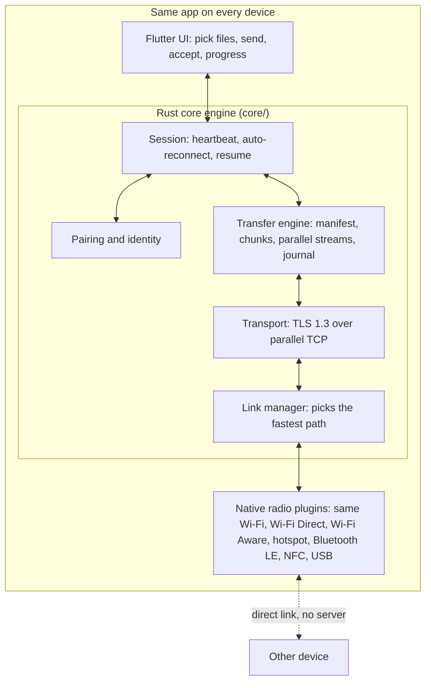
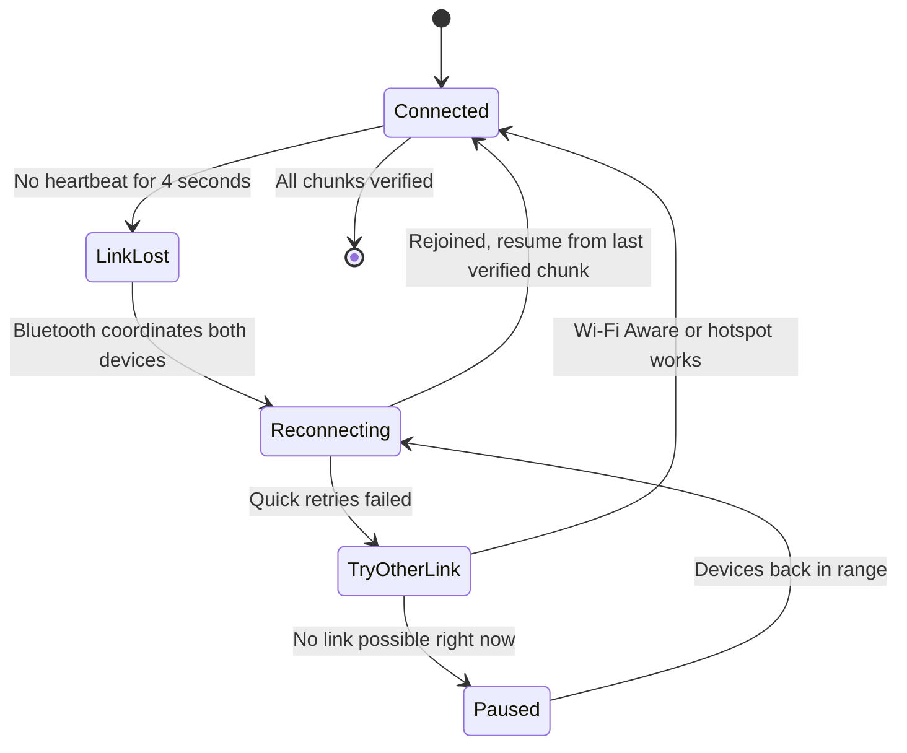
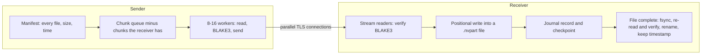

# Nearvolt architecture

Nearvolt moves files directly between nearby devices (phone, tablet, laptop) at the
maximum speed the link allows, with no server, no account and no internet.

Goals, in priority order:

1. **No data loss.** Every byte is verified. Interrupted transfers resume from the
   last verified chunk.
2. **Connections that don't drop easily.** When a link does drop, the app recovers
   automatically in about two seconds.
3. **Maximum speed.** The fastest available link, kept full with parallel streams.
4. **Simple.** Four screens, no ads, no sign-up, a clean light design.

## Layers



| Layer | Technology | Why |
|---|---|---|
| Core engine | Rust | Native speed on every platform, memory safety rules out most security bugs |
| Transport | TLS 1.3 (`rustls`) over 1 control + 8 data TCP connections | Measured 3x faster than QUIC on Windows and cheaper on CPU, which matters for phone battery and heat |
| Verification | BLAKE3 | Faster than SHA-256 and parallel |
| UI | Flutter | One UI for Android, iOS, Windows, macOS and Linux that looks identical everywhere |
| UI to core | `flutter_rust_bridge` | Type-safe calls from Dart into Rust |
| Radios | Kotlin (Android), Swift (Apple), Rust (Windows, Linux) | The OS only exposes radios through native APIs |

## Every radio has one job

| Radio | Job | Why not data |
|---|---|---|
| NFC | Tap to pair: exchanges keys, Wi-Fi details and capabilities | About 424 kbps |
| QR code | Pairing when NFC is missing; works on every phone | Not a data link |
| Bluetooth LE | Discovery, plus a control channel that stays up for the whole transfer | About 2 Mbps; shares the antenna with 2.4 GHz Wi-Fi |
| Wi-Fi | All file data | — |
| USB-C | All file data when a cable is connected | — |

## Link selection

| Devices | Link |
|---|---|
| Any two on the same Wi-Fi | Direct over the local network, found with mDNS |
| Android and Android | Wi-Fi Direct, or Wi-Fi Aware when both support it |
| Android and iPhone | Wi-Fi Aware on iOS 26+, otherwise the iPhone joins Android's local hotspot |
| iPhone and iPhone or Mac | Apple peer-to-peer Wi-Fi through Network.framework |
| Phone and Windows or Linux laptop | The laptop creates a hotspot (Wi-Fi Direct on Windows) and the phone joins |
| Android and Mac | The Mac joins Android's local hotspot |
| USB cable | Android to Android through accessory mode; phone to laptop through USB tethering |

All of these end up as an IP path, so the same transport runs on top of every
link. The link manager only decides how to get that IP path.

## Fast connection setup

1. Pairing (NFC tap, QR code or Bluetooth) hands over a **ticket**: the receiver's
   key fingerprint, a one-time secret, its addresses, and for Wi-Fi Direct the
   group name, password and channel.
2. The receiver creates the Wi-Fi group itself on a fixed channel. The sender joins
   that channel directly: no device search and no confirmation pop-up.
3. Bluetooth discovery starts when the app opens, and the Wi-Fi group is created
   while the user is still picking files.
4. Paired devices are remembered, so reconnecting to them is near-instant.
5. Permissions and radio switches are checked before the user taps Send.

Target: 1 to 3 seconds from tap to data flowing.

## Staying connected

| Cause of drops | Fix |
|---|---|
| Wi-Fi Direct on a different channel from the home router | Create the group on the router's channel |
| Background Wi-Fi scans and radio power saving | Low-latency Wi-Fi lock and wake lock during transfers |
| Battery optimizers killing the app | `connectedDevice` foreground service, battery exemption, brand-specific guide |
| Screen lock tearing down Wi-Fi Direct | Keep the screen on with a dimmed transfer screen |
| Idle group timeout | Heartbeat every 500 ms on the control connection |
| Distance and bodies | Live signal indicator that asks users to move closer |

The **session** is separate from the **connection**: it has its own ID, keys and a
journal of verified chunks, and survives any number of connection drops.



## Transfer pipeline



- One session carries every file. There's no handshake per file, so thousands of
  small files flow back to back on the same streams.
- Large files are split into 4 MiB chunks, each verified with BLAKE3.
- The receiver reserves the full file size up front and writes each chunk directly
  to its final position.
- Photos and video are not compressed, because they already are.
- On resume, the receiver reports which chunks it already has, and only the rest
  are sent. Chunks written after the last checkpoint are re-verified from disk
  first, so a power cut can't cause silent corruption.

## Code layout

```
Nearvolt/
├── core/                 Rust engine (nearvolt-core)
│   └── src/
│       ├── identity.rs   device key and certificate
│       ├── pairing.rs    tickets for QR, NFC and Bluetooth
│       ├── protocol.rs   wire messages and chunk frames
│       ├── transport.rs  TLS 1.3 over TCP with pinned certificates
│       ├── safety.rs     file-name cleaning
│       └── transfer/     manifest, sender, receiver, journal, disk I/O
├── tools/
│   ├── bench/            CLI for sending, receiving, benchmarks and failure tests
│   ├── setup.ps1         downloads the toolchain into .toolchain/
│   └── env.ps1           activates the toolchain in one terminal
├── app/                  Flutter app for all platforms
└── docs/
```

## Measured results

On the development PC (Windows, corporate security software, loopback, so sender
and receiver share one machine), with every byte verified afterward:

| Test | Result |
|---|---|
| One 2 GB file | 357 MB/s |
| 2,000 files of 250 KB | 51 MB/s (this PC's raw ceiling for creating, flushing and renaming small files is 75 MB/s) |
| Mixed: 2 GB of large files plus 1,000 photos | 189 MB/s |
| Link cut for 6 seconds mid-transfer | Detected in 4 s, resumed from the last verified chunk |
| Both apps killed mid-transfer, then restarted | Resumed from the journal |
| Link cut and apps killed in the same transfer | Completed, byte-for-byte identical |

Raw network ceilings on this PC: 919 MB/s for 8 TCP connections, about 300 MB/s for
the best QUIC setup. Run `nearvolt-bench local <folder>` to reproduce.

## Build phases

1. **Core engine and test tool** (now). Speed, verification and resume proven
   between two laptops and over loopback, including simulated link drops and
   killed apps.
2. **Android app.** Wi-Fi Direct with ticket-based setup, NFC and QR pairing,
   Bluetooth control channel, foreground service.
3. **Desktop apps.** Windows first, then macOS and Linux.
4. **iPhone app.** Needs a Mac with Xcode.
5. **Launch.** USB modes, multi-link combining, external security review.
