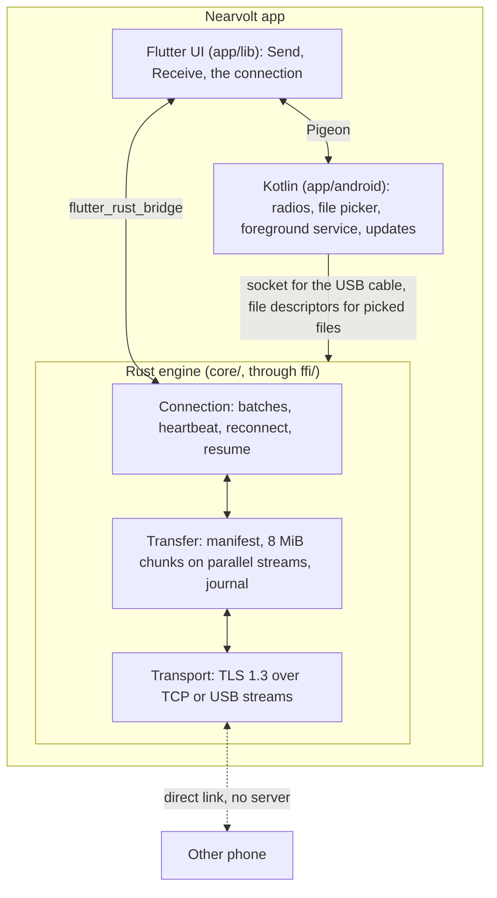
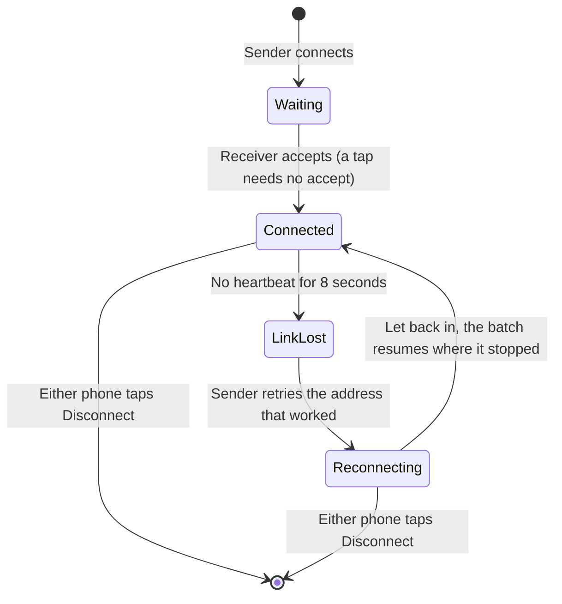
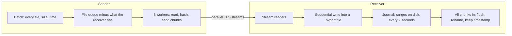

# Nearvolt architecture

Nearvolt moves files directly between nearby Android phones and tablets at the
maximum speed the link allows, with no server, no account and no internet.

Goals, in priority order:

1. **No data loss.** Every file is verified on disk before it's saved.
   Interrupted transfers resume where they stopped.
2. **Connections that stay up.** Two phones stay connected until someone taps
   Disconnect; when the link drops, it comes back on its own the same way it
   was made.
3. **Maximum speed.** The fastest available link, kept full with parallel streams.
4. **Simple.** Two pages and a prompt, no ads, no sign-up, a clean light design.

## Layers



| Layer | Technology | Why |
|---|---|---|
| Engine | Rust | Native speed, and memory safety rules out most security bugs |
| Transport | TLS 1.3 (`rustls`), 1 control + 8 data streams | Measured 3x faster than QUIC and cheaper on CPU, which matters for battery and heat |
| Verification | BLAKE3 | Faster than SHA-256 and parallel |
| UI | Flutter, atomic design (`theme`, `ui/atoms`, `molecules`, `organisms`, `templates`, `pages`) | One set of building blocks reused by every page |
| UI to engine | `flutter_rust_bridge` | Type-safe calls and event streams from Dart into Rust |
| UI to Android | Pigeon | One typed interface (`app/pigeons/platform.dart`) instead of string channels |

## Ways to connect

Every way to connect ends in the same thing: the sender gets the receiver's
ticket (or a USB stream) and the engine takes over.

| How | What happens | Pairing |
|---|---|---|
| Nearby list, same Wi-Fi | The receiver advertises its public ticket over mDNS (`_nearvolt._tcp`) | 4-digit code |
| Nearby list, Bluetooth | The receiver advertises over Bluetooth LE; the sender reads the public ticket from a GATT characteristic. The ticket has no Wi-Fi Direct details, so this works when the phones can already reach each other | 4-digit code |
| QR code | The sender scans the receiver's private ticket with Google's code scanner | Secret in the ticket; the receiver accepts once |
| NFC tap | The receiver's phone acts as an NFC card (host card emulation) serving its tap ticket | Its own secret; the tap is the consent, no prompt |
| USB cable | Android Open Accessory, with streams multiplexed by yamux | 4-digit code |

When Receive opens, the receiver creates a Wi-Fi Direct group (on the router's
channel when Wi-Fi Direct may use it), and the ticket carries its name,
passphrase and frequency. A sender that finds a group in the ticket joins it
first, without a pop-up, asking for the Nearby devices permission only then if
it's missing, and connects through the group alone, even when both phones share
a Wi-Fi network: phone to phone, the files cross the air once instead of twice
(to the router and on to the other phone). If joining fails, the sender tries
every address in the ticket, the router's included, and the first that answers
is used from then on, including for reconnects.

Finding a phone and moving files are separate jobs. Bluetooth, NFC, the local
network's service records and QR codes only exchange the ticket; files always
travel over Wi-Fi (the shared network or Wi-Fi Direct) or the USB cable. The
sender picks one way to connect, and only that one runs, asking only for what it
needs: every way but the cable needs Wi-Fi on, tapping also needs NFC, and the
Nearby list also needs the Nearby devices permission and Bluetooth. Receive
offers every way at once, since it can't know
which the sender picks. Once connected, all of it stops: the sender stops
searching, and the receiver stops advertising and closes its Wi-Fi Direct group
unless the sender joined it.

## Staying connected

| Cause of drops | Fix |
|---|---|
| Wi-Fi Direct on a different channel from the home router | The group is created on the router's channel |
| Background Wi-Fi scans and radio power saving | Low-latency Wi-Fi lock and wake lock while connected |
| The system killing a background app | `connectedDevice` foreground service with progress in a notification |
| Silent link loss | Heartbeat every 500 ms; 8 seconds of silence means the link is gone |
| Short Wi-Fi stalls, for example when an unused Wi-Fi Direct group closes | Under 8 seconds, TCP carries the connection through without a reconnect |
| A cable pulled out | The engine waits for it to be plugged back in and resumes |

A **connection** outlives any number of link drops. The receiver accepts a
phone once; while that phone is connected, others are turned away, and the same
phone reconnecting is let back in without asking. The sender adds batches of
files whenever it likes, and they're sent one after another.



## Transfer pipeline



- One connection carries every batch. There's no handshake per file, so
  thousands of small files flow back to back on the same streams.
- A file is cut into 8 MiB chunks, so even one big file uses all eight streams.
  Each chunk carries its own BLAKE3 hash and is checked as it arrives.
- Picked files are opened one at a time, through file descriptors from Android's
  file picker, so the app needs no storage permission.
- A file is saved under its real name only after every chunk of it matched its
  BLAKE3 hash and the part file was flushed.
- On resume, the receiver reports which ranges of each file are safely on disk,
  and the sender sends only the gaps.

## Code layout

```
Nearvolt/
├── core/                    Rust engine (nearvolt-core)
│   ├── src/
│   │   ├── identity.rs      device key and certificate
│   │   ├── pairing.rs       tickets and the 4-digit code
│   │   ├── protocol.rs      wire messages and file headers
│   │   ├── transport.rs     TLS 1.3 over TCP, or over a multiplexed cable
│   │   ├── safety.rs        file-name cleaning
│   │   └── transfer/        manifest, sender, receiver, journal, disk I/O
│   └── tests/               end-to-end transfers
├── ffi/                     the engine as the app sees it (flutter_rust_bridge)
├── app/
│   ├── lib/                 Flutter: theme, ui/, pages/, engine/
│   ├── pigeons/             the Dart-Kotlin interface
│   ├── android/app/src/main/kotlin/app/nearvolt/
│   │                        one small class per radio, plus the service and updater
│   └── test/                flow tests on a fake engine, golden screenshots
├── tools/
│   ├── bench/               CLI for sending, receiving, benchmarks and failure tests
│   ├── setup.ps1            downloads the toolchain into .toolchain/
│   └── env.ps1              activates the toolchain in one terminal
├── .github/workflows/       CI, and a signed release on every push to main
└── docs/
```

## Measured results

On the development PC (Windows, corporate security software, loopback, so sender
and receiver share one machine), with every byte verified afterward:

| Test | Result |
|---|---|
| One 2 GB file | 274 MB/s (one stream; includes reading it back from disk to verify) |
| 2,000 files of 250 KB | 89 MB/s |
| Mixed: 2 GB of large files plus 1,000 photos | 233 MB/s |
| Link cut for 6 seconds mid-transfer | Carried through without reconnecting |
| Link cut for 12 seconds mid-transfer | Detected after 8 s, reconnected, resumed where it stopped |
| Both apps killed mid-transfer, then restarted | Resumed from the journal |
| Link cut and apps killed in the same transfer | Completed, byte-for-byte identical (149 MB/s including both outages) |

Raw network ceilings on this PC: 919 MB/s for 8 TCP connections, about 300 MB/s for
the best QUIC setup. Run `nearvolt-bench local <folder>` to reproduce. Phone
results come from [the device tests](testing.md).

## Build phases

1. **Engine and test tool.** Done.
2. **Android app** with every way to connect, signed releases and in-app updates.
   Built; waiting on [the device tests](testing.md).
3. **Desktop and iPhone apps.** Later; the engine already runs on desktops.
